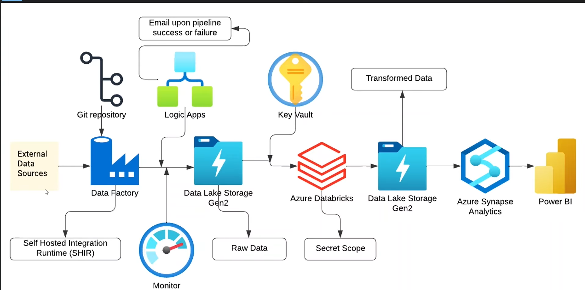

# Azure CRM Sales Data Pipeline


An end-to-end Azure data engineering pipeline for **CRM sales opportunity data**. Data from an on-premises SQL Server is ingested through Azure Data Factory (via a Self-Hosted Integration Runtime), landed in Azure Data Lake Storage Gen2, cleaned and transformed with PySpark in Azure Databricks, and monitored with automated email alerts through Azure Logic Apps.


## 📐 Architecture Overview


---

## Business Problem

Sales teams track accounts, products and deals across multiple operational tables. This data usually lives in on-premises systems, is inconsistent, and is hard to analyse in one place.

This project builds an automated, cloud-based pipeline that:

- Moves CRM data from an on-premises SQL Server to the cloud securely
- Stores raw data untouched, so it can always be reprocessed
- Cleans and standardises the data at scale using PySpark
- Notifies the team automatically when a pipeline run succeeds or fails

---

## Tech Stack

| Layer | Technology | Purpose |
|---|---|---|
| Source | SQL Server (on-premises) | Operational CRM data |
| Connectivity | Self-Hosted Integration Runtime | Secure bridge between on-prem and Azure |
| Orchestration | Azure Data Factory | Pipeline scheduling and data movement |
| Version control | Git / GitHub (ADF Git integration) | Source control for ADF artifacts |
| Storage | Azure Data Lake Storage Gen2 | `raw-data` and `transformed-data` containers |
| Transformation | Azure Databricks, PySpark | Cleaning and transformation |
| Secrets | Azure Key Vault + Databricks secret scope | No hardcoded credentials |
| Alerting | Azure Logic Apps | Email notifications on pipeline success or failure |

---

## Dataset

The project uses a CRM sales opportunities dataset made up of five tables:

| File | Description |
|---|---|
| `accounts.csv` | Customer company accounts |
| `products.csv` | Product catalogue |
| `sales_pipeline.csv` | Sales opportunities and their deal progress |
| `sales_teams.csv` | Sales agents, managers and regional offices |
| `data_dictionary.csv` | Column definitions for the dataset |

---

## Pipeline Walkthrough

### Step 1 - Ingestion with Azure Data Factory

- A **Self-Hosted Integration Runtime** is installed on the machine hosting SQL Server, so ADF can reach on-premises data without exposing the database publicly.
- A **Copy Data** activity moves each table from SQL Server into the `raw-data` container of ADLS Gen2.
- Linked service credentials are stored in **Azure Key Vault**.
- The ADF workspace is connected to **GitHub** for version control.

### Step 2 - Raw Storage in ADLS Gen2

- `raw-data` holds an untouched copy of the source data, kept for reprocessing and auditing.

### Step 3 - Transformation with Azure Databricks

Notebooks read directly from ADLS using the `abfss://` protocol, with credentials pulled from Key Vault through a secret scope:

```python
storage_account = "<your-storage-account>"

spark.conf.set(
    f"fs.azure.account.key.{storage_account}.dfs.core.windows.net",
    dbutils.secrets.get(scope="<your-scope>", key="<your-secret-key>")
)

accounts_df = (
    spark.read.format("csv")
    .option("header", "true")
    .option("inferSchema", "true")
    .load(f"abfss://raw-data@{storage_account}.dfs.core.windows.net/accounts.csv")
)
```

Transformations applied (edit to match your notebook):
- [ ] Data type corrections
- [ ] Null and duplicate handling
- [ ] Column standardisation
- [ ] Joins across accounts, products, pipeline and sales teams
- [ ] Output written to the `transformed-data` container

### Step 4 - Curated Storage in ADLS Gen2

- `transformed-data` holds the cleaned, analytics-ready output from Databricks.

---

## Security

- No credentials are hardcoded anywhere in this repository
- Secrets are stored in **Azure Key Vault** and read in Databricks through a **secret scope**
- The on-premises database is never exposed publicly; access goes through the Self-Hosted Integration Runtime
- Sensitive values in this repo are replaced with placeholders such as `<your-storage-account>`

---

## Monitoring and Alerts

### Steps 5 and 6 - Logic App and Email Notification

A Logic App is called from the ADF pipeline on success and on failure, and sends an email so issues are caught without manually checking the portal.

| Event | Action |
|---|---|
| Pipeline succeeds | Logic App sends a success email |
| Pipeline fails | Logic App sends a failure email |

---

## Challenges and Solutions

| Challenge | Solution |
|---|---|
| ADF could not reach the on-premises SQL Server | Installed and registered a Self-Hosted Integration Runtime |
| Reusing the IR across a second ADF workspace | Registered the existing IR node with a new authentication key |
| `dbutils.fs.mount()` failed ("not whitelisted") on serverless compute | Replaced mounts with direct `abfss://` access using account key credentials from a secret scope |
| Serverless compute rejected the storage config | Created a classic all-purpose cluster for the notebooks |
| Gmail connector failed in Logic Apps (insufficient authentication scopes) | Switched to the Outlook / Office 365 connector |
| Illegal character in `abfss://` URI | Corrected missing `f` prefix on f-strings used in file paths |

---

## Author

**Lavanshi Bansal**
Data Engineer | Azure | PySpark | Power BI
📍 Delhi, India

[]([https://linkedin.com/in/lavanshibansal/)]
[](https://github.com/lavanshi295/)
